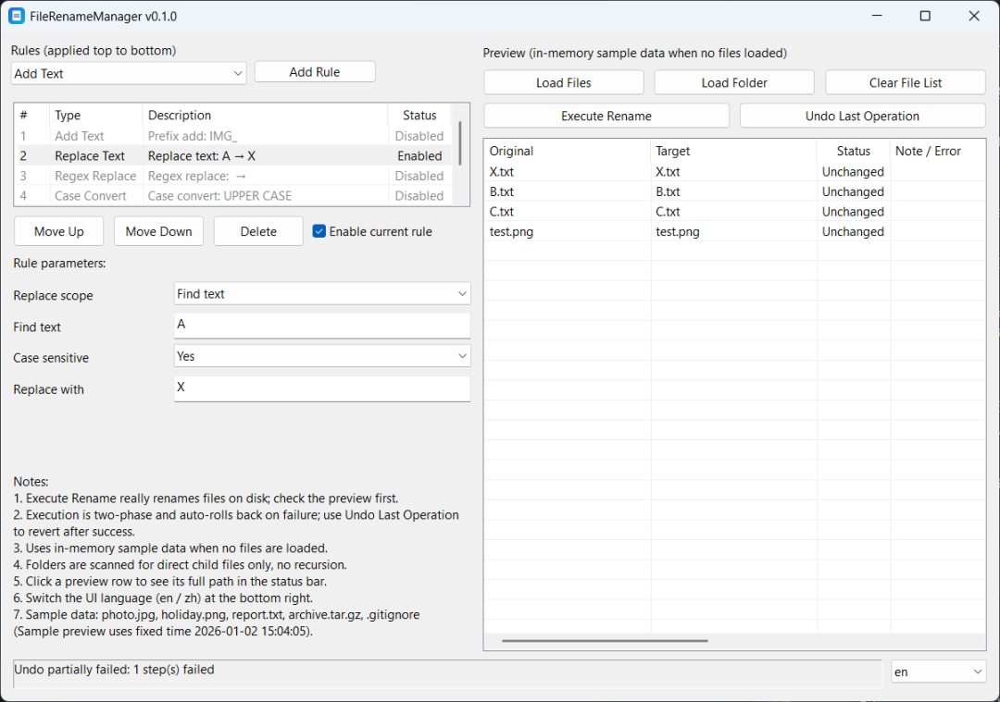

**English** | [简体中文](README.zh-CN.md)

# FileRenameManager

A native Windows desktop application for **rule-based batch file renaming**, built with [aardio](https://aardio.com) — a Windows rapid desktop development environment.

- **Version:** 0.1.0
- Application icon: [`app.ico`](app.ico)

## Features

- **Rule-based batch renaming** with six rule types:
  - **Add text** — prefix / suffix / custom character position
  - **Text replacement** — whole name, or scoped (first N chars, last N chars, from a position, before/after a character, N chars before/after a character), with an optional case-insensitive match
  - **Regular-expression replacement** — with common presets (digits, non-digits, letters, Chinese characters, whitespace, dates, text in parentheses/brackets, trailing digits, …)
  - **Case conversion** — UPPER / lower / First-letter upper / Title Case
  - **Number sequence** — start / step / zero-padding / position (start or end)
  - **Date/time naming** — several date formats, inserted at the start or end of the name. Enable **Use file modified time** to use each file's modification time; leave it off to use the current time. (If a file has no readable modification time, the current time is used as a fallback.)
- **Multiple rules** apply top-to-bottom; rules can be added, deleted, reordered, and enabled/disabled.
- **Live in-memory preview** of original → target names before any file is touched.
- **Conflict detection & pre-execution validation** — invalid characters, Windows reserved names, trailing space/dot, duplicate targets, and targets occupied by files inside or outside the current batch.
- **Two-phase rename planning** (via temporary `~$rename_*` names) is used automatically only when needed — dependency chains, cycles, or case-only changes; otherwise a single-phase rename is used to reduce file moves.
- **Automatic rollback** of already-executed steps if execution fails partway.
- **Undo** for the last eligible operation.
- **Responsive UI** — execution runs in a background thread and preview refresh is debounced.
- **English (default) and Simplified Chinese** UI, switchable at runtime.

## Platform & languages

- **Platform:** Windows (native desktop application; the published program is a portable EXE).
- **UI languages:** English (default) and Simplified Chinese. Switch via the language box at the bottom-right of the window.

## Screenshots

*Main window — English UI. See [README.zh-CN.md](README.zh-CN.md) for the Simplified Chinese UI.*

## Quick start

### Run from source (requires aardio)

1. Install the **aardio IDE** (Windows).
2. Open `main.aardio` in the project root and press **F5**.
3. Click **Load Files** or **Load Folder** to add files.
4. Add and configure rules on the left; the preview updates automatically.
5. Click **Execute Rename**, review the confirmation, and check the result dialog.
6. Use **Undo Last Operation** to revert the last eligible operation.

### Basic usage notes

- With no files loaded, the preview uses built-in **in-memory sample data** (no real files are involved).
- Loading a folder scans its **direct child files only** — subfolders are **not** scanned (non-recursive).
- Click a preview row to see its full source/target path in the status bar.

## How renaming works

1. **Preview** — computed in memory from the loaded files and the current rules. **Preview never modifies any file.**
2. **Pre-check & validation** — before execution, the whole plan is validated:
   - **Errors block execution entirely** (nothing is touched).
   - **Warnings** (e.g. chained renames where a target is occupied by another file in the same batch) are shown but may proceed.
   - If there are **zero executable operations** (everything blocked/skipped), the app shows a notice instead of a confirmation dialog.
3. **Conflict detection** — duplicate targets, and targets occupied by files inside or outside the batch, are detected and reported.
4. **Execution** — happens only after you confirm. **Execution really renames files on disk** and runs in a background thread.
5. **Rollback** — if any step fails, the executor attempts to roll back the steps already executed, to return to the pre-execution state.
6. **Undo** — after a successful execution you can undo the last eligible operation; steps are reverted in reverse order.

## Safety notes

- **Preview does not modify files.**
- **Execute Rename really renames files on disk.** Always review the preview first.
- **Rollback is a best-effort recovery, not an unconditional guarantee.** If rollback itself fails (for example, a file is locked by another program), some steps may not be restored. The result dialog reports whether auto-restore fully succeeded.
- **Undo** is available only for eligible operations and only within the current session — history is kept in memory and is **not** persisted across application restarts.
- **Back up important files before renaming.** Rollback and undo are best-effort recovery features; they do not guarantee recovery in every failure or filesystem condition.

## Limitations

- Folder loading is **non-recursive** (direct child files only).
- **Long file names / very deep paths:** the app does not add the Windows `\\?\` long-path prefix and does not enforce `MAX_PATH`, so such operations may fail. Rollback is attempted after a failure, but it is only best-effort — if rollback itself fails, some files may stay renamed and **manual recovery may be needed**. Back up important files beforehand.
- **Emoji / surrogate-pair characters:** character-position rules (first/last N chars, position, first-letter, sequence position, …) may count an emoji as two characters, so position-based results can differ from intuition.
- **Undo history is in-memory only** and does not survive an application restart.
- Regular-expression replacement relies on aardio's `preg` engine in UTF-8 mode.
- **Performance (single measured run, 2026-10-17, Windows 11 / Core i7-12700H):** 1,000 files — preview 46 ms, execute 282 ms; 10,000 files — preview 547 ms, execute 2,922 ms. Timings are machine- and disk-dependent; see `tests/manual/` for the method and how to re-measure.

## Building & publishing

- Open the project in the **aardio IDE** (open `main.aardio`) and press **F5** to run.
- To publish, use the IDE's publish command. The output is configured in `default.aproj` (`output="FileRenameManager.exe"`, `publishDir="/dist/"`), producing a portable EXE under `dist/`.
- The application icon is `app.ico` (referenced by `default.aproj`).
- The version shown in the title bar comes from the project version settings (`default.aproj` → `FileVersion` / `ProductVersion`, editable via **工程 → 属性** in the IDE). Current: **0.1.0**.
- Project libraries under `lib/` are embedded into the published EXE (`libEmbed="true"`), so the EXE runs without the source directory.

## Tests

Automated tests live under `tests/`. Open any `tests/*.aardio` in the aardio IDE and press **F5** to run. `tests/manual/` contains manual/stability test documentation and a performance test template.

## Reporting bugs & contributing

- When reporting a bug, please include clear steps to reproduce, your Windows version, and the aardio version.
- Contributions are welcome — please keep changes focused and run the existing tests before submitting.
- Use the project's hosting page (its issue tracker) to report bugs or submit pull requests.

## License

Distributed under the terms in [`LICENSE`](LICENSE) — a source-available, proprietary license.
Copyright (c) 2026 LiteKitHub. All rights reserved.

In short: the **v0.1.0 binary** may be downloaded, installed and run free of charge for personal or internal business use. The **source code** is publicly viewable, but building, modifying, redistributing or creating derivative works from it requires prior written permission from the copyright holder. See the `LICENSE` file for the exact terms.
