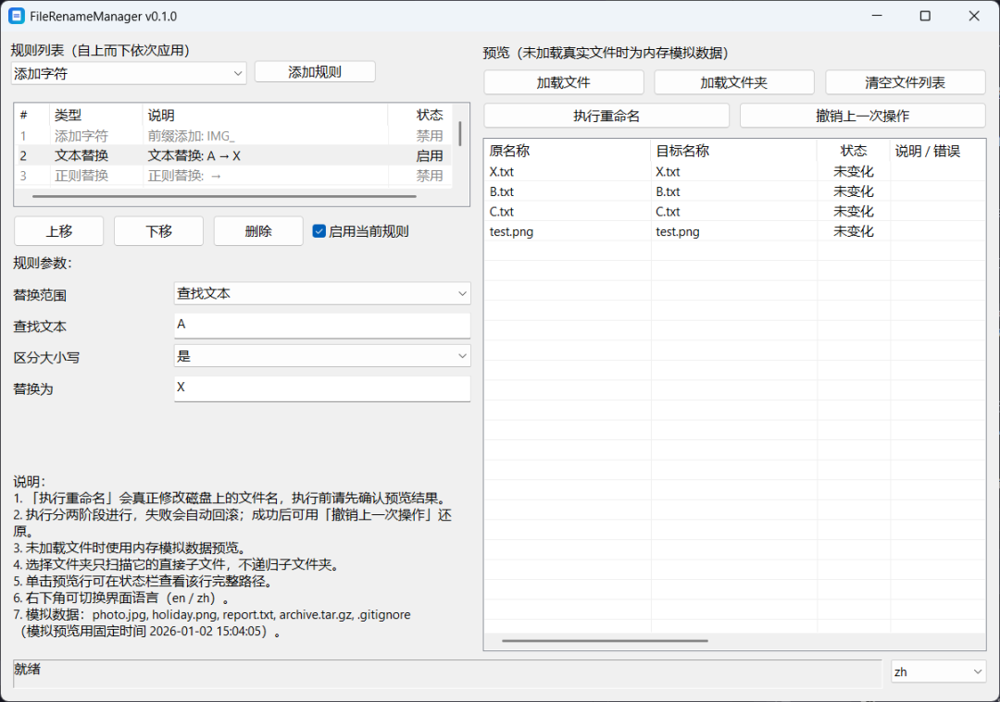

[English](README.md) | **简体中文**

# FileRenameManager

一个用于**规则化批量文件重命名**的 Windows 原生桌面应用，使用 [aardio](https://aardio.com)（Windows 快速桌面开发环境）构建。

- **版本：** 0.1.0
- 应用图标：[`app.ico`](app.ico)

## 功能特性

- **规则化批量重命名**，支持六类规则：
  - **添加字符** —— 前缀 / 后缀 / 指定字符位置
  - **文本替换** —— 整个文件名，或按范围（前 N 个字符、后 N 个字符、指定位置起、指定字符之前/之后、指定字符前后 N 个），可忽略大小写
  - **正则替换** —— 内置常用正则预设（数字、非数字、字母、中文字符、空白、日期、括号/方括号内内容、末尾数字等）
  - **大小写转换** —— 全部大写 / 全部小写 / 首字母大写 / 标题格式
  - **数字序列** —— 起始值 / 步长 / 补零位数 / 位置（开头或末尾）
  - **日期时间命名** —— 多种日期格式，置于文件名开头或末尾。勾选**使用文件修改时间**则使用各文件的修改时间；不勾选则使用当前时间。（文件取不到修改时间时，回退为当前时间。）
- **多条规则**自上而下依次应用；规则可添加、删除、上移/下移、启用/禁用。
- **实时内存预览** —— 在触碰任何文件之前预览 原名 → 目标名。
- **冲突检测与执行前校验** —— 非法字符、Windows 保留名、结尾空格或点、重复目标、目标被本批次内外文件占用等。
- **两阶段重命名计划**（经由临时名 `~$rename_*`）—— 仅在需要时自动启用：依赖链、循环，或仅大小写变化；否则使用单阶段重命名以减少文件移动次数。
- **失败自动回滚** —— 执行中途失败时，自动回滚已执行的步骤。
- **撤销** —— 可撤销上一次符合条件的操作。
- **界面响应** —— 执行在后台线程进行，预览刷新做了防抖。
- **英文（默认）与简体中文**界面，可运行时切换。

## 平台与语言

- **平台：** Windows（原生桌面应用；发布后为便携 EXE）。
- **界面语言：** 英文（默认）与简体中文。通过窗口右下角的语言下拉框切换。

## 截图

*主窗口 —— 简体中文界面。英文界面见 [README.md](README.md)。*

## 快速开始

### 从源码运行（需要 aardio）

1. 安装 **aardio IDE**（Windows）。
2. 打开工程根目录的 `main.aardio`，按 **F5**。
3. 点击**加载文件**或**加载文件夹**添加文件。
4. 在左侧添加并配置规则；预览会自动刷新。
5. 点击**执行重命名**，查看确认弹窗与结果弹窗。
6. 需要回退时点击**撤销上一次操作**。

### 基本使用说明

- 未加载文件时，预览使用内置的**内存模拟数据**（不涉及真实文件）。
- 加载文件夹只扫描其**直接子文件** —— 不扫描子文件夹（非递归）。
- 单击预览某一行，可在状态栏查看该行完整的源路径/目标路径。

## 重命名的工作原理

1. **预览** —— 基于已加载文件与当前规则在内存中计算。**预览绝不修改任何文件。**
2. **预检与校验** —— 执行前对整份计划进行校验：
   - **错误会完全阻止执行**（不触碰任何文件）。
   - **警告**（例如链式重命名，目标被本批次其它文件占用）会提示但可以继续。
   - 若**可执行操作数为 0**（全部被阻止/跳过），应用会给出提示而不再弹出确认框。
3. **冲突检测** —— 检测并报告重复目标、目标被本批次内外文件占用等情况。
4. **执行** —— 仅在你确认后进行。**执行会真正修改磁盘上的文件名**，并在后台线程运行。
5. **回滚** —— 任一步骤失败时，执行器会尝试回滚已执行的步骤，以恢复到执行前状态。
6. **撤销** —— 成功执行后，可撤销上一次符合条件的操作；步骤按逆序还原。

## 安全须知

- **预览不会修改文件。**
- **执行重命名会真正修改磁盘上的文件名。** 请务必先核对预览结果。
- **回滚是尽力恢复，并非无条件保证。** 若回滚本身失败（例如文件被其它程序锁定），部分步骤可能无法还原。结果弹窗会报告自动恢复是否完全成功。
- **撤销**仅对符合条件的操作可用，且仅在当前会话内有效 —— 历史记录保存在内存中，**不会**跨应用重启持久化。
- **重命名前请备份重要文件。** 回滚与撤销都是尽力恢复机制，并不保证在任何失败或文件系统状况下都能恢复。

## 已知限制

- 加载文件夹为**非递归**（仅直接子文件）。
- **长文件名 / 超深目录：** 应用不添加 Windows `\\?\` 长路径前缀，也不强制 `MAX_PATH`，因此此类操作可能失败。失败后会尝试回滚，但回滚只是尽力而为 —— 若回滚本身也失败，部分文件可能保持已改名状态，**可能需要人工恢复**。请提前备份重要文件。
- **Emoji / 代理对字符：** 按字符位置的规则（前/后 N 个字符、指定位置、首字母、序列位置等）可能把一个 emoji 计为 2 个字符，位置类结果可能与直觉不符。
- **撤销历史仅存于内存**，不随应用重启保留。
- 正则替换依赖 aardio 的 `preg` 引擎（UTF-8 模式）。
- **性能（单次实测，2026-10-17，Windows 11 / Core i7-12700H）：** 1000 个文件预览 46 ms、执行 282 ms；10000 个文件预览 547 ms、执行 2922 ms。耗时与机器、磁盘相关，测量方法与复测方式见 `tests/manual/`。

## 构建与发布

- 在 **aardio IDE** 中打开工程（打开 `main.aardio`），按 **F5** 运行。
- 发布请使用 IDE 的发布命令。输出在 `default.aproj` 中配置（`output="FileRenameManager.exe"`、`publishDir="/dist/"`），在 `dist/` 下生成便携 EXE。
- 应用图标为 `app.ico`（由 `default.aproj` 引用）。
- 标题栏显示的版本号取自工程版本设置（`default.aproj` 的 `FileVersion` / `ProductVersion`，可在 IDE 的**工程 → 属性**中编辑）。当前：**0.1.0**。
- `lib/` 下的工程库会嵌入发布后的 EXE（`libEmbed="true"`），因此 EXE 可脱离源码目录运行。

## 测试

自动化测试位于 `tests/`。在 aardio IDE 中打开任意 `tests/*.aardio`，按 **F5** 运行。`tests/manual/` 为手动/稳定性测试文档与性能测试模板。

## 报告缺陷与参与贡献

- 报告缺陷时，请附上清晰的重现步骤、你的 Windows 版本以及 aardio 版本。
- 欢迎参与贡献 —— 请保持改动聚焦，并在提交前运行现有测试。
- 请通过项目的托管页面（其 issue 跟踪器）报告缺陷或提交 pull request。

## 许可

本项目按 [`LICENSE`](LICENSE) 中的条款分发 —— 源码可见（source-available）的专有许可。
Copyright (c) 2026 LiteKitHub。保留所有权利。

简言之：**v0.1.0 二进制程序**可免费下载、安装并用于个人用途或企业内部使用；**源码**可公开查看，但基于源码进行构建、修改、再分发或创建衍生作品，需事先获得版权持有人的书面许可。具体条款请见 `LICENSE` 文件。
